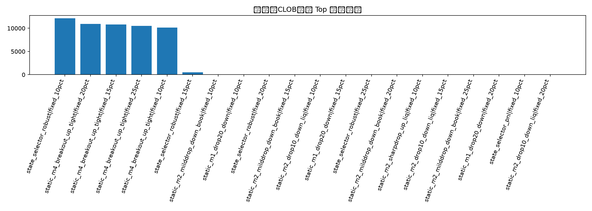
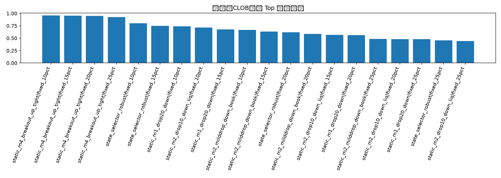

# monthly_runs 全历史 CLOB 数据：系统性策略研究

这份报告只使用 `data/monthly_runs/*` 里已经从 Polymarket CLOB 拉下来的真实事件数据，不依赖额外外部数据。

## 数据覆盖

| run_name             |   file_count |   raw_row_count |   markets |
|:---------------------|-------------:|----------------:|----------:|
| 24949259015_attempt1 |           48 |           39535 |       290 |
| 24952032748_attempt1 |           48 |           36019 |       290 |
| 24986940107_attempt1 |           48 |           40793 |       289 |
| 25044896828_attempt1 |           48 |           39723 |       290 |
| 25100490855_attempt1 |           48 |           40583 |       290 |
| 25157440693_attempt1 |           48 |           40774 |       289 |
| 25208977834_attempt1 |           48 |           40558 |       289 |
| 25247789591_attempt1 |           48 |           38790 |       290 |
| 25274678535_attempt1 |           48 |           39865 |       290 |
| 25311264469_attempt1 |           48 |           41955 |       289 |
| 25367630341_attempt1 |           48 |           39433 |       289 |
| 25427145257_attempt1 |           48 |           42213 |       289 |
| 25487949887_attempt1 |           48 |           38628 |       290 |
| 25545252940_attempt1 |           48 |           42129 |       290 |
| 25596809734_attempt1 |           48 |           41252 |       290 |
| 25624592440_attempt1 |           48 |           38959 |       290 |
| 25665168591_attempt1 |           48 |           39795 |       290 |
| 25726497649_attempt1 |           21 |           17380 |       127 |
| 25791429807_attempt1 |           48 |           41466 |       289 |
| 25852951350_attempt1 |           48 |           42646 |       290 |
| 25911485679_attempt1 |           48 |           43355 |       290 |
| 25957739510_attempt1 |           48 |           44234 |       290 |
| 25986690554_attempt1 |           48 |           41729 |       290 |
| 26029755017_attempt1 |           48 |           41183 |       289 |
| 26091905404_attempt1 |           48 |           39368 |       290 |
| 26156603287_attempt1 |           48 |           43682 |       290 |
| 26221008452_attempt1 |           48 |           42392 |       290 |
| 26282408844_attempt1 |           22 |           19934 |       132 |
| 26328797356_attempt1 |           13 |           12169 |        79 |
| 26357456273_attempt1 |           48 |           39586 |       290 |
| 26709070227_attempt1 |           48 |           39628 |       290 |
| 26709294970_attempt1 |           48 |           39828 |       290 |
| 26755468029_attempt1 |           48 |           39695 |       289 |
| 26832707302_attempt1 |           48 |           39271 |       289 |
| 26944523023_attempt1 |           48 |           41103 |       290 |
| 27008365180_attempt1 |           48 |           41830 |       287 |
| 27059341408_attempt1 |           48 |           44964 |       290 |
| 27089462916_attempt1 |           48 |           40712 |       290 |
| 27130700451_attempt1 |           48 |           40996 |       290 |
| 27199408085_attempt1 |           48 |           40945 |       290 |
| 27269618919_attempt1 |           48 |           41355 |       290 |
| 27340390720_attempt1 |           48 |           40724 |       289 |
| 27410119221_attempt1 |           48 |           41690 |       289 |
| 27464308599_attempt1 |           48 |           41293 |       290 |
| 27496226714_attempt1 |           48 |           42567 |       290 |
| 27540844174_attempt1 |           48 |           41823 |       290 |
| 27612222130_attempt1 |           48 |           41285 |       290 |
| 27683808024_attempt1 |           48 |           39594 |       285 |
| 27754758156_attempt1 |           48 |           43343 |       290 |
| 27821835753_attempt1 |           48 |           40908 |       290 |
| 27869277828_attempt1 |           48 |           43151 |       289 |
| 27902430728_attempt1 |           48 |           41575 |       288 |
| 27948683312_attempt1 |           48 |           38576 |       289 |
| 28022420503_attempt1 |           48 |           39982 |       289 |
| 28095005508_attempt1 |           48 |           40768 |       290 |
| 28166886036_attempt1 |           48 |           40660 |       290 |
| 28235383560_attempt1 |           48 |           41015 |       290 |
| 28288053257_attempt1 |           48 |           41462 |       290 |
| 28321073325_attempt1 |           48 |           40148 |       290 |
| 28369678027_attempt1 |           48 |           43957 |       290 |
| 28442123818_attempt1 |           48 |           41850 |       290 |
| 28515647330_attempt1 |           48 |           41375 |       289 |
| 28588281394_attempt1 |           48 |           41082 |       289 |
| 28659365605_attempt1 |           48 |           39572 |       290 |
| 28705739897_attempt1 |           48 |           43021 |       290 |
| 28740396418_attempt1 |           48 |           42685 |       290 |
| 28790909570_attempt1 |           36 |           30895 |       218 |
| 28847404575_attempt1 |           48 |           39100 |       290 |
| 28923778969_attempt1 |           48 |           39674 |       290 |
| 29000291038_attempt1 |           48 |           44122 |       290 |
| 29075660007_attempt1 |           48 |           39975 |       290 |
| 29144058049_attempt1 |           48 |           40497 |       289 |
| 29183942155_attempt1 |           48 |           42169 |       288 |
| 29231728767_attempt1 |           48 |           39345 |       289 |
| 29314482071_attempt1 |           48 |           38746 |       289 |
| 29397534768_attempt1 |           48 |           40167 |       290 |
| 29480427148_attempt1 |           48 |           39768 |       290 |
| 29563821720_attempt1 |           48 |           39654 |       290 |
| 29636284636_attempt1 |           48 |           39740 |       289 |
| 29678766108_attempt1 |           48 |           40970 |       289 |
| 29726104371_attempt1 |           48 |           40584 |       289 |
| 29812544557_attempt1 |           48 |           41291 |       289 |
| 29902589491_attempt1 |           48 |           37688 |       290 |
| 29990397142_attempt1 |           48 |           38654 |       290 |
| 30078303224_attempt1 |           48 |           44604 |       290 |
| 30150922378_attempt1 |            7 |            6438 |        43 |
| 30837944463_attempt1 |           48 |           38602 |       290 |
| 30935583061_attempt1 |           48 |           42096 |       290 |
| 31032083711_attempt1 |           44 |           34765 |       266 |
| 31133984682_attempt1 |           48 |           39920 |       290 |
| 31229843661_attempt1 |           48 |           41650 |       290 |
| 31286152826_attempt1 |           48 |           43028 |       290 |
| 31344660241_attempt1 |           48 |           37359 |       290 |
| 31446652780_attempt1 |           48 |           41873 |       290 |
| 31551135301_attempt1 |           48 |           37183 |       290 |
| 31655639073_attempt1 |           48 |           37492 |       290 |
| 31758884946_attempt1 |           48 |           43851 |       290 |
| 31855226601_attempt1 |           48 |           41445 |       290 |
| 31918731681_attempt1 |           48 |           41312 |       290 |
| 31984133053_attempt1 |           48 |           38885 |       290 |

## 这版明确用到了哪些 CLOB / 流动性指标

| feature                       | category         | description        |
|:------------------------------|:-----------------|:-------------------|
| buy_up_size_2m                | liquidity        | 2分钟买Up可成交量         |
| buy_down_size_2m              | liquidity        | 2分钟买Down可成交量       |
| sell_up_size_2m               | liquidity        | 2分钟卖Up对手量          |
| sell_down_size_2m             | liquidity        | 2分钟卖Down对手量        |
| bid_depth_imbalance_updown_2m | depth            | bid depth不平衡       |
| book_pressure_up_2m           | book_pressure    | Up侧盘口压力            |
| book_pressure_down_2m         | book_pressure    | Down侧盘口压力          |
| size_imbalance_updown_2m      | imbalance        | 买盘量不平衡             |
| sell_size_imbalance_updown_2m | imbalance        | 卖盘量不平衡             |
| spread_up_median_first2m      | spread           | 前2分钟Up spread中位数   |
| spread_down_median_first2m    | spread           | 前2分钟Down spread中位数 |
| overround_median_first2m      | pricing          | 前2分钟overround中位数   |
| trade_count_sum_first2m       | trading_activity | 前2分钟成交笔数总和         |
| trade_volume_sum_first2m      | trading_activity | 前2分钟成交量总和          |
| quote_count_first2m           | quote_activity   | 前2分钟quote数量        |
| realized_vol_first2m          | path             | 前2分钟路径波动           |
| path_efficiency_first2m       | path             | 前2分钟路径效率           |
| max_drawdown_first2m          | path             | 前2分钟最大下探           |
| max_rebound_first2m           | path             | 前2分钟最大反弹           |

## 收益最高 Top 20

| source_layer                | strategy                     | sizing      |   trades |   ending_bankroll |   total_return |   avg_trade_return_on_cost |   median_trade_return_on_cost |   win_rate |   profit_factor |   max_drawdown |   max_consecutive_losses |   avg_entry_minute |   avg_signal_score |   p10_trade_return_on_cost |   score_end |   score_win |   score_pf |   score_dd |   score_streak |   score_tail |   robustness_score |
|:----------------------------|:-----------------------------|:------------|---------:|------------------:|---------------:|---------------------------:|------------------------------:|-----------:|----------------:|---------------:|-------------------------:|-------------------:|-------------------:|---------------------------:|------------:|------------:|-----------:|-----------:|---------------:|-------------:|-------------------:|
| all_monthly_clob_systematic | state_selector_robust        | fixed_10pct |     5350 |        12172.8    |       120.728  |                     0.0575 |                        0.2375 |     0.734  |          1.4919 |         0.9999 |                        5 |             1.6793 |             0.0694 |                    -1.0159 |      1      |      0.5781 |     0.875  |     0.8438 |         0.8281 |       0.5781 |             0.8    |
| all_monthly_clob_systematic | static_m4_breakout_up_tight  | fixed_20pct |      556 |        10951.7    |       108.517  |                     0.4038 |                        0.1647 |     0.8201 |          4.4987 |         0.9923 |                        4 |             4      |           nan      |                    -1.0126 |      0.9688 |      0.9531 |     0.9375 |     0.9375 |         0.9531 |       0.9375 |             0.9484 |
| all_monthly_clob_systematic | static_m4_breakout_up_tight  | fixed_15pct |      556 |        10840.9    |       107.409  |                     0.4038 |                        0.1647 |     0.8201 |          4.5175 |         0.9628 |                        4 |             4      |           nan      |                    -1.0126 |      0.9375 |      0.9531 |     0.9688 |     0.9688 |         0.9531 |       0.9375 |             0.9547 |
| all_monthly_clob_systematic | static_m4_breakout_up_tight  | fixed_25pct |      556 |        10494.5    |       103.945  |                     0.4038 |                        0.1647 |     0.8201 |          4.2895 |         0.9988 |                        4 |             4      |           nan      |                    -1.0126 |      0.9062 |      0.9531 |     0.9062 |     0.9062 |         0.9531 |       0.9375 |             0.9234 |
| all_monthly_clob_systematic | static_m4_breakout_up_tight  | fixed_10pct |      556 |        10151.2    |       100.512  |                     0.4038 |                        0.1647 |     0.8201 |          4.5232 |         0.8604 |                        4 |             4      |           nan      |                    -1.0126 |      0.875  |      0.9531 |     1      |     1      |         0.9531 |       1      |             0.9609 |
| all_monthly_clob_systematic | state_selector_robust        | fixed_15pct |     5350 |          496.394  |         3.9639 |                     0.0575 |                        0.2375 |     0.734  |          1.1762 |         1      |                        5 |             1.6793 |             0.0694 |                    -1.0159 |      0.8438 |      0.5781 |     0.8438 |     0.7812 |         0.8281 |       0.5781 |             0.75   |
| all_monthly_clob_systematic | static_m2_milddrop_down_book | fixed_10pct |     3183 |            0.0315 |        -0.9997 |                     0.0036 |                        0.2692 |     0.6808 |          0.927  |         0.9999 |                        6 |             2      |           nan      |                    -1.0167 |      0.8125 |      0.4531 |     0.6562 |     0.875  |         0.6406 |       0.4531 |             0.6688 |
| all_monthly_clob_systematic | static_m1_drop20_down        | fixed_10pct |     9090 |            0.0122 |        -0.9999 |                     0.0115 |                        0.2375 |     0.7393 |          0.9959 |         1      |                        7 |             1      |           nan      |                    -1.0149 |      0.7812 |      0.7031 |     0.8125 |     0.8125 |         0.4531 |       0.7031 |             0.7375 |
| all_monthly_clob_systematic | state_selector_robust        | fixed_20pct |     5350 |            0.0007 |        -1      |                     0.0575 |                        0.2375 |     0.734  |          0.8211 |         1      |                        5 |             1.6793 |             0.0694 |                    -1.0159 |      0.75   |      0.5781 |     0.375  |     0.6875 |         0.8281 |       0.5781 |             0.6188 |
| all_monthly_clob_systematic | static_m2_milddrop_down_book | fixed_15pct |     3183 |            0      |        -1      |                     0.0036 |                        0.2692 |     0.6808 |          0.9313 |         1      |                        6 |             2      |           nan      |                    -1.0167 |      0.7188 |      0.4531 |     0.6875 |     0.75   |         0.6406 |       0.4531 |             0.6313 |
| all_monthly_clob_systematic | static_m2_drop10_down_liq    | fixed_10pct |    10309 |            0      |        -1      |                    -0.0003 |                        0.1379 |     0.7748 |          0.873  |         1      |                        6 |             2      |           nan      |                    -1.0145 |      0.6875 |      0.8281 |     0.5938 |     0.7188 |         0.6406 |       0.8281 |             0.7125 |
| all_monthly_clob_systematic | static_m1_drop20_down        | fixed_15pct |     9090 |            0      |        -1      |                     0.0115 |                        0.2375 |     0.7393 |          0.9942 |         1      |                        7 |             1      |           nan      |                    -1.0149 |      0.6562 |      0.7031 |     0.7812 |     0.6562 |         0.4531 |       0.7031 |             0.675  |
| all_monthly_clob_systematic | state_selector_robust        | fixed_25pct |     5350 |            0      |        -1      |                     0.0575 |                        0.2375 |     0.734  |          0.7499 |         1      |                        5 |             1.6793 |             0.0694 |                    -1.0159 |      0.625  |      0.5781 |     0.0625 |     0.3125 |         0.8281 |       0.5781 |             0.4562 |
| all_monthly_clob_systematic | static_m2_milddrop_down_book | fixed_20pct |     3183 |            0      |        -1      |                     0.0036 |                        0.2692 |     0.6808 |          0.9321 |         1      |                        6 |             2      |           nan      |                    -1.0167 |      0.5938 |      0.4531 |     0.7188 |     0.625  |         0.6406 |       0.4531 |             0.5875 |
| all_monthly_clob_systematic | static_m2_sharpdrop_up_liq   | fixed_10pct |     2564 |            0      |        -1      |                     0.0875 |                       -1.0435 |     0.2098 |          0.829  |         1      |                       29 |             2      |           nan      |                    -1.1    |      0.5625 |      0.2031 |     0.4062 |     0.3125 |         0.2031 |       0.2031 |             0.3375 |
| all_monthly_clob_systematic | static_m2_drop10_down_liq    | fixed_15pct |    10309 |            0      |        -1      |                    -0.0003 |                        0.1379 |     0.7748 |          0.8355 |         1      |                        6 |             2      |           nan      |                    -1.0145 |      0.5312 |      0.8281 |     0.4375 |     0.3125 |         0.6406 |       0.8281 |             0.5688 |
| all_monthly_clob_systematic | static_m2_milddrop_down_book | fixed_25pct |     3183 |            0      |        -1      |                     0.0036 |                        0.2692 |     0.6808 |          0.9219 |         1      |                        6 |             2      |           nan      |                    -1.0167 |      0.5    |      0.4531 |     0.625  |     0.3125 |         0.6406 |       0.4531 |             0.4875 |
| all_monthly_clob_systematic | static_m1_drop20_down        | fixed_20pct |     9090 |            0      |        -1      |                     0.0115 |                        0.2375 |     0.7393 |          0.9615 |         1      |                        7 |             1      |           nan      |                    -1.0149 |      0.4688 |      0.7031 |     0.75   |     0.3125 |         0.4531 |       0.7031 |             0.5625 |
| all_monthly_clob_systematic | state_selector_pnl           | fixed_10pct |    10416 |            0      |        -1      |                     0.0296 |                        0.1124 |     0.599  |          0.7811 |         1      |                       13 |             1.8291 |             0.0455 |                    -1.0714 |      0.4375 |      0.3281 |     0.25   |     0.3125 |         0.3281 |       0.3281 |             0.3313 |
| all_monthly_clob_systematic | static_m2_drop10_down_liq    | fixed_20pct |    10309 |            0      |        -1      |                    -0.0003 |                        0.1379 |     0.7748 |          0.7658 |         1      |                        6 |             2      |           nan      |                    -1.0145 |      0.4062 |      0.8281 |     0.125  |     0.3125 |         0.6406 |       0.8281 |             0.4813 |

## 稳健性最好 Top 20

| source_layer                | strategy                     | sizing      |   trades |   ending_bankroll |   total_return |   avg_trade_return_on_cost |   median_trade_return_on_cost |   win_rate |   profit_factor |   max_drawdown |   max_consecutive_losses |   avg_entry_minute |   avg_signal_score |   p10_trade_return_on_cost |   score_end |   score_win |   score_pf |   score_dd |   score_streak |   score_tail |   robustness_score |
|:----------------------------|:-----------------------------|:------------|---------:|------------------:|---------------:|---------------------------:|------------------------------:|-----------:|----------------:|---------------:|-------------------------:|-------------------:|-------------------:|---------------------------:|------------:|------------:|-----------:|-----------:|---------------:|-------------:|-------------------:|
| all_monthly_clob_systematic | static_m4_breakout_up_tight  | fixed_10pct |      556 |        10151.2    |       100.512  |                     0.4038 |                        0.1647 |     0.8201 |          4.5232 |         0.8604 |                        4 |             4      |           nan      |                    -1.0126 |      0.875  |      0.9531 |     1      |     1      |         0.9531 |       1      |             0.9609 |
| all_monthly_clob_systematic | static_m4_breakout_up_tight  | fixed_15pct |      556 |        10840.9    |       107.409  |                     0.4038 |                        0.1647 |     0.8201 |          4.5175 |         0.9628 |                        4 |             4      |           nan      |                    -1.0126 |      0.9375 |      0.9531 |     0.9688 |     0.9688 |         0.9531 |       0.9375 |             0.9547 |
| all_monthly_clob_systematic | static_m4_breakout_up_tight  | fixed_20pct |      556 |        10951.7    |       108.517  |                     0.4038 |                        0.1647 |     0.8201 |          4.4987 |         0.9923 |                        4 |             4      |           nan      |                    -1.0126 |      0.9688 |      0.9531 |     0.9375 |     0.9375 |         0.9531 |       0.9375 |             0.9484 |
| all_monthly_clob_systematic | static_m4_breakout_up_tight  | fixed_25pct |      556 |        10494.5    |       103.945  |                     0.4038 |                        0.1647 |     0.8201 |          4.2895 |         0.9988 |                        4 |             4      |           nan      |                    -1.0126 |      0.9062 |      0.9531 |     0.9062 |     0.9062 |         0.9531 |       0.9375 |             0.9234 |
| all_monthly_clob_systematic | state_selector_robust        | fixed_10pct |     5350 |        12172.8    |       120.728  |                     0.0575 |                        0.2375 |     0.734  |          1.4919 |         0.9999 |                        5 |             1.6793 |             0.0694 |                    -1.0159 |      1      |      0.5781 |     0.875  |     0.8438 |         0.8281 |       0.5781 |             0.8    |
| all_monthly_clob_systematic | state_selector_robust        | fixed_15pct |     5350 |          496.394  |         3.9639 |                     0.0575 |                        0.2375 |     0.734  |          1.1762 |         1      |                        5 |             1.6793 |             0.0694 |                    -1.0159 |      0.8438 |      0.5781 |     0.8438 |     0.7812 |         0.8281 |       0.5781 |             0.75   |
| all_monthly_clob_systematic | static_m1_drop20_down        | fixed_10pct |     9090 |            0.0122 |        -0.9999 |                     0.0115 |                        0.2375 |     0.7393 |          0.9959 |         1      |                        7 |             1      |           nan      |                    -1.0149 |      0.7812 |      0.7031 |     0.8125 |     0.8125 |         0.4531 |       0.7031 |             0.7375 |
| all_monthly_clob_systematic | static_m2_drop10_down_liq    | fixed_10pct |    10309 |            0      |        -1      |                    -0.0003 |                        0.1379 |     0.7748 |          0.873  |         1      |                        6 |             2      |           nan      |                    -1.0145 |      0.6875 |      0.8281 |     0.5938 |     0.7188 |         0.6406 |       0.8281 |             0.7125 |
| all_monthly_clob_systematic | static_m1_drop20_down        | fixed_15pct |     9090 |            0      |        -1      |                     0.0115 |                        0.2375 |     0.7393 |          0.9942 |         1      |                        7 |             1      |           nan      |                    -1.0149 |      0.6562 |      0.7031 |     0.7812 |     0.6562 |         0.4531 |       0.7031 |             0.675  |
| all_monthly_clob_systematic | static_m2_milddrop_down_book | fixed_10pct |     3183 |            0.0315 |        -0.9997 |                     0.0036 |                        0.2692 |     0.6808 |          0.927  |         0.9999 |                        6 |             2      |           nan      |                    -1.0167 |      0.8125 |      0.4531 |     0.6562 |     0.875  |         0.6406 |       0.4531 |             0.6688 |
| all_monthly_clob_systematic | static_m2_milddrop_down_book | fixed_15pct |     3183 |            0      |        -1      |                     0.0036 |                        0.2692 |     0.6808 |          0.9313 |         1      |                        6 |             2      |           nan      |                    -1.0167 |      0.7188 |      0.4531 |     0.6875 |     0.75   |         0.6406 |       0.4531 |             0.6313 |
| all_monthly_clob_systematic | state_selector_robust        | fixed_20pct |     5350 |            0.0007 |        -1      |                     0.0575 |                        0.2375 |     0.734  |          0.8211 |         1      |                        5 |             1.6793 |             0.0694 |                    -1.0159 |      0.75   |      0.5781 |     0.375  |     0.6875 |         0.8281 |       0.5781 |             0.6188 |
| all_monthly_clob_systematic | static_m2_milddrop_down_book | fixed_20pct |     3183 |            0      |        -1      |                     0.0036 |                        0.2692 |     0.6808 |          0.9321 |         1      |                        6 |             2      |           nan      |                    -1.0167 |      0.5938 |      0.4531 |     0.7188 |     0.625  |         0.6406 |       0.4531 |             0.5875 |
| all_monthly_clob_systematic | static_m2_drop10_down_liq    | fixed_15pct |    10309 |            0      |        -1      |                    -0.0003 |                        0.1379 |     0.7748 |          0.8355 |         1      |                        6 |             2      |           nan      |                    -1.0145 |      0.5312 |      0.8281 |     0.4375 |     0.3125 |         0.6406 |       0.8281 |             0.5688 |
| all_monthly_clob_systematic | static_m1_drop20_down        | fixed_20pct |     9090 |            0      |        -1      |                     0.0115 |                        0.2375 |     0.7393 |          0.9615 |         1      |                        7 |             1      |           nan      |                    -1.0149 |      0.4688 |      0.7031 |     0.75   |     0.3125 |         0.4531 |       0.7031 |             0.5625 |
| all_monthly_clob_systematic | static_m2_milddrop_down_book | fixed_25pct |     3183 |            0      |        -1      |                     0.0036 |                        0.2692 |     0.6808 |          0.9219 |         1      |                        6 |             2      |           nan      |                    -1.0167 |      0.5    |      0.4531 |     0.625  |     0.3125 |         0.6406 |       0.4531 |             0.4875 |
| all_monthly_clob_systematic | static_m2_drop10_down_liq    | fixed_20pct |    10309 |            0      |        -1      |                    -0.0003 |                        0.1379 |     0.7748 |          0.7658 |         1      |                        6 |             2      |           nan      |                    -1.0145 |      0.4062 |      0.8281 |     0.125  |     0.3125 |         0.6406 |       0.8281 |             0.4813 |
| all_monthly_clob_systematic | static_m1_drop20_down        | fixed_25pct |     9090 |            0      |        -1      |                     0.0115 |                        0.2375 |     0.7393 |          0.8523 |         1      |                        7 |             1      |           nan      |                    -1.0149 |      0.3438 |      0.7031 |     0.4688 |     0.3125 |         0.4531 |       0.7031 |             0.4812 |
| all_monthly_clob_systematic | state_selector_robust        | fixed_25pct |     5350 |            0      |        -1      |                     0.0575 |                        0.2375 |     0.734  |          0.7499 |         1      |                        5 |             1.6793 |             0.0694 |                    -1.0159 |      0.625  |      0.5781 |     0.0625 |     0.3125 |         0.8281 |       0.5781 |             0.4562 |
| all_monthly_clob_systematic | static_m2_drop10_down_liq    | fixed_25pct |    10309 |            0      |        -1      |                    -0.0003 |                        0.1379 |     0.7748 |          0.6555 |         1      |                        6 |             2      |           nan      |                    -1.0145 |      0.3125 |      0.8281 |     0.0312 |     0.3125 |         0.6406 |       0.8281 |             0.4438 |

## 两种“最佳”

- 收益最高：**state_selector_robust | fixed_10pct**，期末本金 **12172.77 USD**，最大回撤 **99.99%**。
- 稳健性最好：**static_m4_breakout_up_tight | fixed_10pct**，稳健得分 **0.9609**，期末本金 **10151.18 USD**，最大回撤 **86.04%**。

## finalist 按 run 的表现

| strategy              | sizing      | run_name             |   trades |   avg_pnl_usd |   total_pnl_usd |   avg_signal_score |   win_rate |
|:----------------------|:------------|:---------------------|---------:|--------------:|----------------:|-------------------:|-----------:|
| state_selector_robust | fixed_10pct | 24949259015_attempt1 |       32 |        0.8438 |         27.0022 |             0.0756 |     0.8125 |
| state_selector_robust | fixed_10pct | 24952032748_attempt1 |       25 |       -1.5163 |        -37.9071 |             0.0525 |     0.72   |
| state_selector_robust | fixed_10pct | 24986940107_attempt1 |       18 |       -1.7849 |        -32.1286 |             0.0375 |     0.5556 |
| state_selector_robust | fixed_10pct | 25044896828_attempt1 |       20 |       -0.8304 |        -16.6083 |             0.0486 |     0.6    |
| state_selector_robust | fixed_10pct | 25100490855_attempt1 |       27 |       -0.2755 |         -7.438  |             0.0599 |     0.7037 |
| state_selector_robust | fixed_10pct | 25157440693_attempt1 |       39 |       -0.2217 |         -8.6458 |             0.0603 |     0.6923 |
| state_selector_robust | fixed_10pct | 25208977834_attempt1 |       28 |       -0.006  |         -0.1685 |             0.0816 |     0.8214 |
| state_selector_robust | fixed_10pct | 25247789591_attempt1 |       65 |        0.2442 |         15.8722 |             0.0796 |     0.8308 |
| state_selector_robust | fixed_10pct | 25274678535_attempt1 |       42 |       -0.5025 |        -21.105  |             0.0677 |     0.619  |
| state_selector_robust | fixed_10pct | 25311264469_attempt1 |       14 |       -0.0473 |         -0.6623 |             0.0716 |     0.7143 |
| state_selector_robust | fixed_10pct | 25367630341_attempt1 |       44 |        0.1873 |          8.2399 |             0.0747 |     0.8182 |
| state_selector_robust | fixed_10pct | 25427145257_attempt1 |       82 |        0.3945 |         32.3471 |             0.0776 |     0.8293 |
| state_selector_robust | fixed_10pct | 25487949887_attempt1 |       61 |       -0.5722 |        -34.907  |             0.0753 |     0.6393 |
| state_selector_robust | fixed_10pct | 25545252940_attempt1 |       31 |       -0.2782 |         -8.6257 |             0.0599 |     0.6452 |
| state_selector_robust | fixed_10pct | 25596809734_attempt1 |       22 |        0.0462 |          1.0156 |             0.0675 |     0.7727 |
| state_selector_robust | fixed_10pct | 25624592440_attempt1 |       10 |       -0.1988 |         -1.9884 |             0.0782 |     0.6    |
| state_selector_robust | fixed_10pct | 25665168591_attempt1 |       82 |        0.6067 |         49.7455 |             0.0954 |     0.8537 |
| state_selector_robust | fixed_10pct | 25726497649_attempt1 |       41 |        0.2235 |          9.1637 |             0.121  |     0.7317 |
| state_selector_robust | fixed_10pct | 25791429807_attempt1 |       75 |        1.4961 |        112.205  |             0.1202 |     0.8267 |
| state_selector_robust | fixed_10pct | 25852951350_attempt1 |       72 |        0.1259 |          9.0627 |             0.0714 |     0.7639 |
| state_selector_robust | fixed_10pct | 25911485679_attempt1 |       64 |       -1.1992 |        -76.7496 |             0.0778 |     0.6719 |
| state_selector_robust | fixed_10pct | 25957739510_attempt1 |       33 |       -1.4278 |        -47.1186 |             0.0524 |     0.6061 |
| state_selector_robust | fixed_10pct | 25986690554_attempt1 |        5 |        4.5506 |         22.7528 |             0.0747 |     1      |
| state_selector_robust | fixed_10pct | 26029755017_attempt1 |       21 |       -2.454  |        -51.534  |             0.0526 |     0.4762 |
| state_selector_robust | fixed_10pct | 26091905404_attempt1 |       37 |       -0.2015 |         -7.4563 |             0.0476 |     0.7027 |
| state_selector_robust | fixed_10pct | 26156603287_attempt1 |       26 |       -0.5031 |        -13.0813 |             0.0466 |     0.6154 |
| state_selector_robust | fixed_10pct | 26221008452_attempt1 |       37 |       -0.0579 |         -2.1414 |             0.0479 |     0.8108 |
| state_selector_robust | fixed_10pct | 26282408844_attempt1 |        9 |        1.2474 |         11.2269 |             0.0567 |     1      |
| state_selector_robust | fixed_10pct | 26328797356_attempt1 |       10 |       -0.3654 |         -3.6541 |             0.0606 |     0.6    |
| state_selector_robust | fixed_10pct | 26357456273_attempt1 |       26 |       -0.2612 |         -6.7915 |             0.0513 |     0.6538 |
| state_selector_robust | fixed_10pct | 26709070227_attempt1 |       35 |       -0.0221 |         -0.7735 |             0.0615 |     0.7429 |
| state_selector_robust | fixed_10pct | 26709294970_attempt1 |       59 |        0.3749 |         22.122  |             0.076  |     0.8136 |
| state_selector_robust | fixed_10pct | 26755468029_attempt1 |       66 |       -0.0298 |         -1.9645 |             0.0708 |     0.7121 |
| state_selector_robust | fixed_10pct | 26832707302_attempt1 |       49 |       -0.3525 |        -17.2713 |             0.0531 |     0.6122 |
| state_selector_robust | fixed_10pct | 26944523023_attempt1 |       36 |       -0.3608 |        -12.9883 |             0.0575 |     0.5    |
| state_selector_robust | fixed_10pct | 27008365180_attempt1 |       25 |       -0.0642 |         -1.6058 |             0.0585 |     0.6    |
| state_selector_robust | fixed_10pct | 27059341408_attempt1 |       24 |       -0.1664 |         -3.9934 |             0.0639 |     0.5    |
| state_selector_robust | fixed_10pct | 27089462916_attempt1 |       13 |       -0.1082 |         -1.4065 |             0.0652 |     0.3846 |
| state_selector_robust | fixed_10pct | 27130700451_attempt1 |       49 |        0.0246 |          1.2074 |             0.0606 |     0.7755 |
| state_selector_robust | fixed_10pct | 27199408085_attempt1 |       21 |       -0.0198 |         -0.415  |             0.0486 |     0.619  |
| state_selector_robust | fixed_10pct | 27269618919_attempt1 |       12 |       -0.0085 |         -0.1023 |             0.0882 |     0.5833 |
| state_selector_robust | fixed_10pct | 27340390720_attempt1 |       29 |       -0.0083 |         -0.2421 |             0.0553 |     0.6897 |
| state_selector_robust | fixed_10pct | 27410119221_attempt1 |       11 |        0.0102 |          0.1126 |             0.0987 |     0.6364 |
| state_selector_robust | fixed_10pct | 27464308599_attempt1 |       14 |       -0.0332 |         -0.4651 |             0.0563 |     0.6429 |
| state_selector_robust | fixed_10pct | 27496226714_attempt1 |       30 |       -0.0134 |         -0.4016 |             0.0715 |     0.6667 |
| state_selector_robust | fixed_10pct | 27540844174_attempt1 |       13 |       -0.006  |         -0.0778 |             0.0485 |     0.6923 |
| state_selector_robust | fixed_10pct | 27612222130_attempt1 |       29 |        0.004  |          0.1166 |             0.0488 |     0.6897 |
| state_selector_robust | fixed_10pct | 27683808024_attempt1 |       15 |       -0.0256 |         -0.3842 |             0.0598 |     0.6    |
| state_selector_robust | fixed_10pct | 27754758156_attempt1 |       96 |        0.0084 |          0.8065 |             0.0617 |     0.7812 |
| state_selector_robust | fixed_10pct | 27821835753_attempt1 |       60 |        0.007  |          0.4173 |             0.0605 |     0.8    |
| state_selector_robust | fixed_10pct | 27869277828_attempt1 |       40 |       -0.0305 |         -1.2194 |             0.0512 |     0.625  |
| state_selector_robust | fixed_10pct | 27902430728_attempt1 |       16 |       -0.0441 |         -0.7051 |             0.0487 |     0.5    |
| state_selector_robust | fixed_10pct | 27948683312_attempt1 |       14 |        0.0061 |          0.085  |             0.0557 |     0.7857 |
| state_selector_robust | fixed_10pct | 28022420503_attempt1 |       47 |       -0.0011 |         -0.0518 |             0.0437 |     0.7872 |
| state_selector_robust | fixed_10pct | 28095005508_attempt1 |       46 |       -0.0071 |         -0.3252 |             0.0511 |     0.6957 |
| state_selector_robust | fixed_10pct | 28166886036_attempt1 |       46 |       -0.0019 |         -0.0881 |             0.0514 |     0.6957 |
| state_selector_robust | fixed_10pct | 28235383560_attempt1 |       30 |       -0.0035 |         -0.104  |             0.0452 |     0.7    |
| state_selector_robust | fixed_10pct | 28288053257_attempt1 |       26 |       -0.002  |         -0.0525 |             0.0482 |     0.6923 |
| state_selector_robust | fixed_10pct | 28321073325_attempt1 |       23 |       -0.002  |         -0.0461 |             0.0499 |     0.6957 |
| state_selector_robust | fixed_10pct | 28369678027_attempt1 |       40 |        0.0004 |          0.0147 |             0.0491 |     0.825  |
| state_selector_robust | fixed_10pct | 28442123818_attempt1 |       21 |       -0.0007 |         -0.0144 |             0.0541 |     0.619  |
| state_selector_robust | fixed_10pct | 28515647330_attempt1 |        7 |       -0.0054 |         -0.0376 |             0.0797 |     0.2857 |
| state_selector_robust | fixed_10pct | 28588281394_attempt1 |       28 |        0.0002 |          0.0048 |             0.0544 |     0.75   |
| state_selector_robust | fixed_10pct | 28659365605_attempt1 |       40 |        0.0004 |          0.0161 |             0.0634 |     0.775  |
| state_selector_robust | fixed_10pct | 28705739897_attempt1 |       24 |       -0.0012 |         -0.03   |             0.0797 |     0.6667 |
| state_selector_robust | fixed_10pct | 28740396418_attempt1 |       29 |        0.0007 |          0.0212 |             0.0461 |     0.8276 |
| state_selector_robust | fixed_10pct | 28790909570_attempt1 |       17 |       -0.0003 |         -0.0059 |             0.0517 |     0.7059 |
| state_selector_robust | fixed_10pct | 28847404575_attempt1 |       44 |       -0.0003 |         -0.0115 |             0.0623 |     0.7273 |
| state_selector_robust | fixed_10pct | 28923778969_attempt1 |       43 |        0.0002 |          0.0083 |             0.0552 |     0.7674 |
| state_selector_robust | fixed_10pct | 29000291038_attempt1 |       22 |       -0.0003 |         -0.0077 |             0.0701 |     0.6818 |
| state_selector_robust | fixed_10pct | 29075660007_attempt1 |       16 |       -0.001  |         -0.0166 |             0.0548 |     0.625  |
| state_selector_robust | fixed_10pct | 29144058049_attempt1 |       37 |        0.0008 |          0.0288 |             0.0508 |     0.8378 |
| state_selector_robust | fixed_10pct | 29183942155_attempt1 |       47 |        0.0001 |          0.0024 |             0.0605 |     0.766  |
| state_selector_robust | fixed_10pct | 29231728767_attempt1 |       15 |       -0.0014 |         -0.0215 |             0.0612 |     0.6    |
| state_selector_robust | fixed_10pct | 29314482071_attempt1 |       13 |       -0.0013 |         -0.0167 |             0.0572 |     0.5385 |
| state_selector_robust | fixed_10pct | 29397534768_attempt1 |       33 |       -0.0003 |         -0.0083 |             0.0535 |     0.697  |
| state_selector_robust | fixed_10pct | 29480427148_attempt1 |       52 |        0      |          0.002  |             0.0586 |     0.75   |
| state_selector_robust | fixed_10pct | 29563821720_attempt1 |       36 |        0.0008 |          0.0284 |             0.0592 |     0.8333 |
| state_selector_robust | fixed_10pct | 29636284636_attempt1 |       25 |        0.0013 |          0.0331 |             0.0818 |     0.88   |
| state_selector_robust | fixed_10pct | 29678766108_attempt1 |       64 |        0.0001 |          0.0046 |             0.0687 |     0.7656 |
| state_selector_robust | fixed_10pct | 29726104371_attempt1 |       52 |       -0.0009 |         -0.0482 |             0.0635 |     0.6731 |
| state_selector_robust | fixed_10pct | 29812544557_attempt1 |       39 |        0.0004 |          0.0149 |             0.0519 |     0.8462 |
| state_selector_robust | fixed_10pct | 29902589491_attempt1 |       43 |        0.0002 |          0.0067 |             0.0572 |     0.7442 |
| state_selector_robust | fixed_10pct | 29990397142_attempt1 |       27 |       -0.0003 |         -0.0083 |             0.0589 |     0.7407 |
| state_selector_robust | fixed_10pct | 30078303224_attempt1 |       17 |        0.0034 |          0.0579 |             0.0889 |     0.8235 |
| state_selector_robust | fixed_10pct | 30150922378_attempt1 |        2 |       -0.0048 |         -0.0096 |             0.0477 |     0.5    |
| state_selector_robust | fixed_10pct | 30837944463_attempt1 |        8 |        0.0049 |          0.0392 |             0.098  |     0.875  |
| state_selector_robust | fixed_10pct | 30935583061_attempt1 |       18 |       -0.0023 |         -0.0414 |             0.1003 |     0.5556 |
| state_selector_robust | fixed_10pct | 31032083711_attempt1 |       23 |        0      |          0.0005 |             0.0547 |     0.7826 |
| state_selector_robust | fixed_10pct | 31133984682_attempt1 |       16 |       -0      |         -0.0002 |             0.0786 |     0.6875 |
| state_selector_robust | fixed_10pct | 31229843661_attempt1 |       12 |       -0.0011 |         -0.0133 |             0.0459 |     0.8333 |
| state_selector_robust | fixed_10pct | 31286152826_attempt1 |       10 |        0.0048 |          0.048  |             0.0689 |     1      |
| state_selector_robust | fixed_10pct | 31344660241_attempt1 |       21 |        0.0038 |          0.0797 |             0.0862 |     0.9048 |
| state_selector_robust | fixed_10pct | 31446652780_attempt1 |       20 |        0.0004 |          0.0079 |             0.0841 |     0.7    |
| state_selector_robust | fixed_10pct | 31551135301_attempt1 |       17 |       -0.0033 |         -0.0569 |             0.0831 |     0.5882 |
| state_selector_robust | fixed_10pct | 31655639073_attempt1 |       16 |       -0.003  |         -0.0479 |             0.0958 |     0.5625 |
| state_selector_robust | fixed_10pct | 31758884946_attempt1 |       22 |        0.0002 |          0.0048 |             0.0616 |     0.7273 |
| state_selector_robust | fixed_10pct | 31855226601_attempt1 |        4 |        0.0077 |          0.0307 |             0.0695 |     1      |
| state_selector_robust | fixed_10pct | 31918731681_attempt1 |        2 |        0.0044 |          0.0087 |             0.0418 |     1      |
| state_selector_robust | fixed_10pct | 31984133053_attempt1 |       12 |        0.0036 |          0.0426 |             0.0681 |     0.8333 |

## 图表

